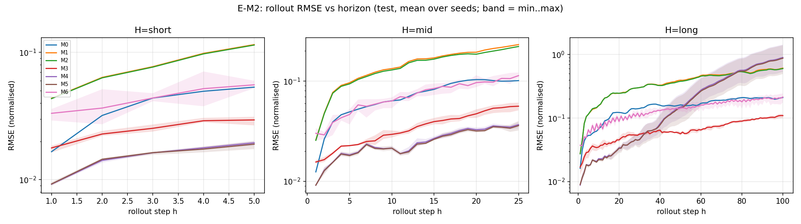
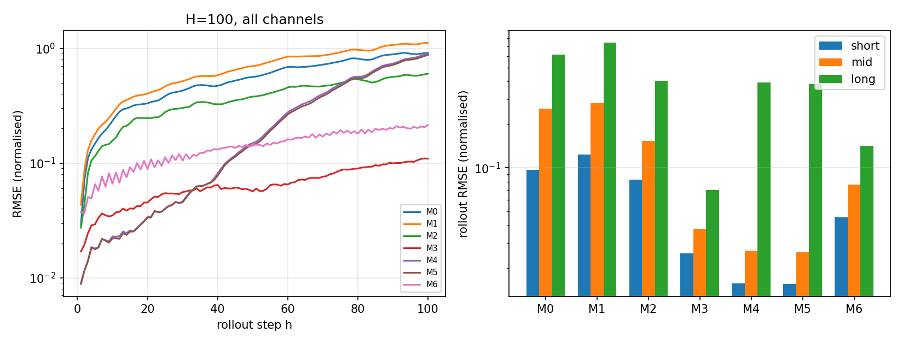

# WP-M 建模比较报告（E-M1 / E-M2）

> **状态**：临时实验材料，**不是论文正文**；数值全部由 `scripts/report_modeling.py`
> 从 `results/modeling/gate1_ledger.json` 自动生成，无手工填写。
> **协议**：`configs/modeling_protocol.yaml`；数据与划分 `configs/data_manifest.yaml`、
> `configs/split_manifest.yaml`；窗口/起点/归一化/分位数的**唯一**实现是 `models/protocol.py`（RMSE 公式在 Gate 1/4 脚本内联重算，数值等价但非同一函数调用）。

## 1. 设置摘要

| 项 | 值 |
|---|---|
| 数据 | 真实平台采集；100 条记录 × 300 步；dt = 0.2 s |
| 划分 | 按完整轨迹 70/20/10（train/val/test），train-only 归一化常数冻结 |
| 历史窗口 | P = 8 测量 + P−1 = 7 过去输入；当前输入 u_k 不进 context |
| 预测任务 | one-step x_{k+1}；自回归开环 H ∈ {5, 25, 100} |
| 评估起点 | 冻结整数算法生成，所有模型/种子完全相同 |
| 选择准则 | validation 多步 rollout RMSE（H=25），**从不使用 test** |
| 搜索预算 | 每模型 6 trial（random search）→ 选定配置 3 seed 重训 → test 一次评估 |
| 随机种子 | 0, 1, 2（线性基线 M0/M1 为闭式解，确定性） |
| 硬件 | NVIDIA RTX 4060 Laptop 8 GB；torch 2.6.0+cu124 |

## 2. E-M1 基线主表（test，归一化单位，mean ± std，3 seeds）

归一化分母为 train-only `x_std`。**不报告单一最优 seed**。

| 方法 | one-step | roll H=5 | roll H=25 | roll H=100 | 参数量 |
|---|---|---|---|---|---|
| M0 DMDc (linear state space) | 0.0176 | 0.0965 ± 0.0000 | 0.2591 ± 0.0000 | 0.6135 ± 0.0000 | 0 |
| M1 EDMDc (fixed dictionary) | 0.0444 | 0.1238 ± 0.0000 | 0.2812 ± 0.0000 | 0.7445 ± 0.0000 | 0 |
| M2 EDMD-DL with control (learnable dictionary) | 0.0433 | 0.0828 ± 0.0002 | 0.1546 ± 0.0001 | 0.4051 ± 0.0035 | 230 |
| M3 LSTM/GRU controlled predictor | 0.0178 | 0.0253 ± 0.0010 | 0.0377 ± 0.0024 | 0.0700 ± 0.0028 | 4770 |
| M4 old model A(c) + fixed B0 | 0.0093 | 0.0157 ± 0.0003 | 0.0265 ± 0.0008 | 0.3932 ± 0.1695 | 20818 |
| M5 new model A(c) + B(x) | 0.0094 | 0.0155 ± 0.0004 | 0.0258 ± 0.0008 | 0.3819 ± 0.1659 | 20872 |
| M6 Controlled Transformer | 0.0359 | 0.0451 ± 0.0059 | 0.0765 ± 0.0063 | 0.1427 ± 0.0201 | 55042 |

**禁止**把不同通道的平均误差当作全部信息；逐通道结果见下节。

### 2.1 逐通道 RMSE（H=25，归一化单位）

| 方法 | channel 0 | channel 1 |
|---|---|---|
| M0 | 0.2722 ± 0.0000 | 0.2453 ± 0.0000 |
| M1 | 0.2959 ± 0.0000 | 0.2656 ± 0.0000 |
| M2 | 0.1591 ± 0.0003 | 0.1499 ± 0.0004 |
| M3 | 0.0382 ± 0.0004 | 0.0371 ± 0.0045 |
| M4 | 0.0272 ± 0.0010 | 0.0254 ± 0.0005 |
| M5 | 0.0265 ± 0.0016 | 0.0249 ± 0.0004 |
| M6 | 0.0804 ± 0.0095 | 0.0748 ± 0.0047 |

### 2.2 辅助指标（H=25）

| 方法 | 误差中位数 q50 | q90 | q99 | 评估耗时/seed (s) |
|---|---|---|---|---|
| M0 | 0.2953 | 0.5702 | 0.8197 | 0.1 |
| M1 | 0.3154 | 0.6249 | 0.8638 | 0.2 |
| M2 | 0.1801 | 0.3430 | 0.4636 | 0.1 |
| M3 | 0.0355 | 0.0832 | 0.1523 | 0.1 |
| M4 | 0.0255 | 0.0616 | 0.0963 | 0.2 |
| M5 | 0.0257 | 0.0589 | 0.0877 | 0.2 |
| M6 | 0.0755 | 0.1666 | 0.3370 | 0.4 |

### 2.3 逐 seed 明细（H=100 的种子间差异，暴露发散/不稳定）

| 方法 | seed 0 | seed 1 | seed 2 | 均值 ± 标准差 |
|---|---|---|---|---|
| M0 | 0.6135 | 0.6135 | 0.6135 | 0.6135 ± 0.0000 |
| M1 | 0.7445 | 0.7445 | 0.7445 | 0.7445 ± 0.0000 |
| M2 | 0.4098 | 0.4013 | 0.4043 | 0.4051 ± 0.0035 |
| M3 | 0.0711 | 0.0662 | 0.0728 | 0.0700 ± 0.0028 |
| M4 | 0.3072 | 0.2425 | 0.6299 | 0.3932 ± 0.1695 |
| M5 | 0.3136 | 0.2216 | 0.6104 | 0.3819 ± 0.1659 |
| M6 | 0.1711 | 0.1279 | 0.1291 | 0.1427 ± 0.0201 |

> 若某方法的种子间差异与均值同量级（例如 ±0.17 vs 0.39），说明它在 H=100 上**不稳定**，
> 不能只报均值。此处逐 seed 列出，供判断。

### 2.4 配对比较（同 seed 差值，H=25）

计划书 §10 要求「必要时做配对比较」。由于所有模型使用**同一测试起点集合**且每个模型用相同种子 0/1/2，
同 seed 差值就是配对量。n = 3，**不做显著性断言**，只列出差值。

| 对比 | seed 0 差值 | seed 1 | seed 2 | 均值 ± 标准差 |
|---|---|---|---|---|
| M4 − M5 | -0.0005 | +0.0029 | -0.0003 | +0.0007 ± 0.0015 |
| M5 − M3 | -0.0110 | -0.0102 | -0.0147 | -0.0120 ± 0.0019 |
| M4 − M6 | -0.0590 | -0.0464 | -0.0446 | -0.0500 ± 0.0064 |
| M5 − M2 | -0.1279 | -0.1300 | -0.1285 | -0.1288 ± 0.0009 |
| M4 − M0 | -0.2331 | -0.2315 | -0.2333 | -0.2326 ± 0.0008 |

> 负值表示左侧方法误差更小。**同号且绝对值远大于标准差**才算一致差异；
> 本表 n=3，只用于观察方向与量级，不用于宣称显著性。

### 2.5 跨轨迹方差（统计单位 = 一条独立测试轨迹；seed 0 补充诊断）

计划书 §2.3 要求以**独立实验轨迹**为统计单位，避免重叠窗口造成的伪重复。
本节为**单 seed** 补充诊断（`single-seed supplementary diagnostic; the main table uses 3 seeds`），不替代多 seed 主表。

| 方法 | 逐轨迹 RMSE 均值 | 方差 | 最小 | 最大 | 最差轨迹 |
|---|---|---|---|---|---|
| M0 | 0.2574 | 0.00090 | 0.2020 | 0.2968 | traj 3 |
| M1 | 0.2772 | 0.00223 | 0.1952 | 0.3525 | traj 7 |
| M2 | 0.1523 | 0.00067 | 0.1038 | 0.1939 | traj 7 |
| M3 | 0.0359 | 0.00012 | 0.0174 | 0.0583 | traj 2 |
| M4 | 0.0259 | 0.00003 | 0.0209 | 0.0397 | traj 4 |
| M5 | 0.0265 | 0.00003 | 0.0190 | 0.0370 | traj 4 |
| M6 | 0.0706 | 0.00043 | 0.0459 | 0.1248 | traj 3 |

## 3. E-M2 预测误差随 horizon

## 4. 失败与异常记录（不得从主指标静默排除）

| 模型 | trial | 状态 | 说明 |
|---|---|---|---|
| — | — | — | 本次搜索无失败 trial |

已记录的真实缺陷（见 `reports/control_comparison.md` §2.1 与 DEC-085）：

1. rollout 语义错误（每步重新编码 → 已改为 latent 递归传播），导致首轮 Gate 1 训练全部作废重跑；
2. 目标函数缺常数项（已修正）；
3. 首轮长时训练因**主机内存**（16 GB，训练时仅余约 3 GB）耗尽而中断，
   报错表现为 CUDA OOM（GPU 实际仅占用 32 MiB）。已改为逐模型独立进程 + 显式内存回收 + batch 128。

## 5. 入选配置（validation 选择，test 只评估一次）

| 模型 | 配置 |
|---|---|
| M0 | `{"delay": 1, "epochs": 50}` (val roll25 = 0.265515) |
| M1 | `{"n_rbf": 0, "sigma": 0.5, "ridge": 1e-08, "epochs": 50}` (val roll25 = 0.299170) |
| M2 | `{"d_lift": 8, "hidden": 16, "ridge": 1e-08, "lr": 0.001, "epochs": 80}` (val roll25 = 0.167295) |
| M3 | `{"cell": "gru", "hidden": 32, "layers": 1, "lr": 0.003, "w_roll": 1.0, "roll_h": 10, "epochs": 50}` (val roll25 = 0.034825) |
| M4 | `{"r_A": 3, "r_B": 3, "g_A": 0.1, "g_B": 0.02, "d_model": 32, "n_layers": 2, "lr": 0.001, "w_roll": 1.0, "roll_h": 20, "epochs": 50}` (val roll25 = 0.025498) |
| M5 | `{"r_A": 3, "r_B": 3, "g_A": 0.1, "g_B": 0.02, "d_model": 32, "n_layers": 2, "lr": 0.001, "w_roll": 1.0, "roll_h": 20, "epochs": 50}` (val roll25 = 0.025055) |
| M6 | `{"d_model": 64, "n_layers": 2, "lr": 0.001, "w_roll": 0.0, "roll_h": 5, "epochs": 50}` (val roll25 = 0.067460) |

## 6. E-M3 结构消融（配对：同 encoder / 窗口 / latent / 损失 / 预算）

配对配置（取自 M5 的入选配置，四个结构共用）：`{"r_A": 3, "r_B": 3, "g_A": 0.1, "g_B": 0.02, "d_model": 32, "n_layers": 2, "lr": 0.001, "w_roll": 1.0, "roll_h": 20, "epochs": 50}`

| 结构 | roll H=25 | roll H=100 | one-step | 参数量 |
|---|---|---|---|---|
| A0B0 | 0.0756 ± 0.0012 | 0.8803 | 0.0211 | 20656 |
| AcB0 | 0.0265 ± 0.0008 | 0.3932 | 0.0093 | 20818 |
| A0Bx | 0.0744 ± 0.0010 | 0.9376 | 0.0210 | 20710 |
| AcBx | 0.0258 ± 0.0008 | 0.3819 | 0.0094 | 20872 |

## 7. E-M4 容量/预算匹配

目标：把 `A(c)+B0` 放大到与新模型同参数量级，防止把参数量增加误当调度结构收益。

| 项 | 值 |
|---|---|
| 新模型参数量 | 20872 |
| 匹配后的 `A(c)+B0` | d_model=32, r_A=3, 参数量=20818 (相对误差 0.3%) |
| 匹配后 roll H=25 | 0.0265 ± 0.0008 |

## 8. E-M5 调度诊断（test 起点，采样经验界；**不是**全局 Lipschitz 证书）

| 结构 | ‖A(c)−A0‖₂ max | ‖B(χ)−B0‖₂ max | ρ(A) max | ΔA 有效秩(90%) | 输入响应相对差 |
|---|---|---|---|---|---|
| A0B0 | 0.0000 | 0.0000 | 1.0273 | 0 | 0.000 |
| AcB0 | 0.0277 | 0.0000 | 1.0086 | 3 | 0.000 |
| A0Bx | 0.0000 | 0.0109 | 1.0291 | 0 | 0.012 |
| AcBx | 0.0272 | 0.0123 | 1.0106 | 3 | 0.022 |

## 9. 结论与局限

**结论按数据填写，不预设优劣。** 见 §2 主表。

局限：

- 数据只有单一工况集合，**不支持跨工况泛化**结论；
- 测试起点在同一批 10 条轨迹内均匀取样，轨迹间差异见分位数指标；
- 超参搜索为 6 trial/模型（算力受限），不保证接近各方法的最优配置；
- M3/M6 的递推是「把预测测量与已知未来输入喂回输入序列」，与 scheduled Koopman 的 latent 递归传播是不同的递推策略，已在报告中注明；
- 本节所有误差为**离线预测**误差，不含任何闭环控制含义。

